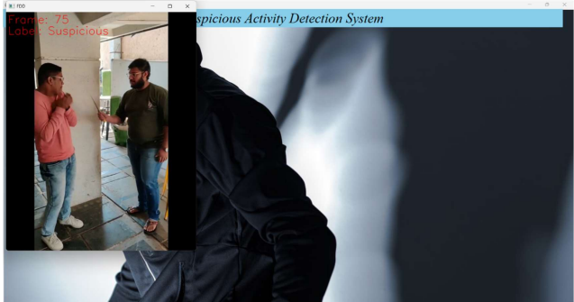
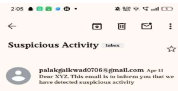
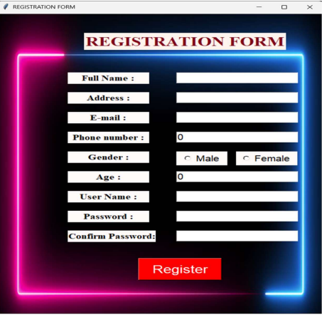
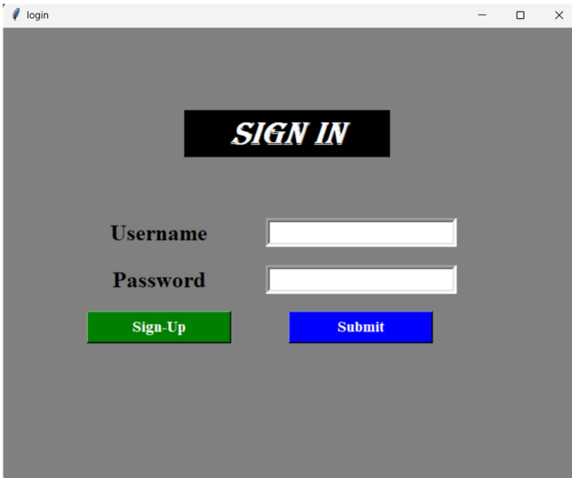

# Suspicious Activity Detection

A computer vision and deep learning project designed to analyze surveillance video footage and identify potentially suspicious activities. The system integrates video processing, a trained deep learning model, a graphical user interface, and email notifications to support automated surveillance monitoring.

## Overview

Manual monitoring of surveillance footage can be time-consuming, especially when large amounts of video need to be reviewed. This project explores how computer vision and deep learning can assist in identifying suspicious activities from video input.

The application allows users to register and log in through a graphical interface, select video footage for analysis, and receive email notifications when suspicious activity is detected.

## Key Features

- **Video Processing:** Processes video input and extracts frames for analysis.
- **Deep Learning-Based Detection:** Uses a trained model to classify activity in the video.
- **Graphical User Interface:** Provides a desktop interface for authentication and interacting with the application.
- **Email Notifications:** Sends alerts when suspicious activity is detected.
- **Modular Components:** Includes separate scripts for video processing, model training, authentication, and application functionality.

## Technology Stack

- **Programming Language:** Python
- **Computer Vision:** OpenCV
- **Deep Learning:** TensorFlow, Keras
- **Numerical Processing:** NumPy
- **Image Processing:** Pillow, scikit-image
- **GUI:** Tkinter
- **Email Notifications:** Python's built-in `smtplib` library

## Project Workflow

1. The user registers or logs in through the graphical interface.
2. The user selects a video for analysis.
3. The application processes the video and prepares frames for the detection pipeline.
4. The trained model is used to identify potentially suspicious activity.
5. An email notification is triggered when the detection logic identifies suspicious activity.

## Getting Started

### Prerequisites

- Python 3.9
- Required Python libraries
- The trained model files and any other assets required by the application

### Installation

**1. Clone the repository**

```bash
git clone https://github.com/PalakGaikwad/suspicious-activity-detection.git
cd suspicious-activity-detection
```

**2. Install the Python dependencies**

```bash
pip install numpy opencv-python pillow tensorflow keras scikit-image
```

**3. Configure email notifications**

Configure the sender email and authentication credentials securely before using the email alert functionality. Do not commit passwords or other sensitive information to GitHub.

**4. Run the application**

```bash
python suspiciousGUI_main.py
```

The application may require additional configuration or supporting files depending on the existing project setup.


## Screenshots

### Suspicious Activity Detection


### Email Alert


### User Registration


### User Login


## Author

**Palak Gaikwad**

[GitHub Profile](https://github.com/PalakGaikwad) · [Project Repository](https://github.com/PalakGaikwad/suspicious-activity-detection)
